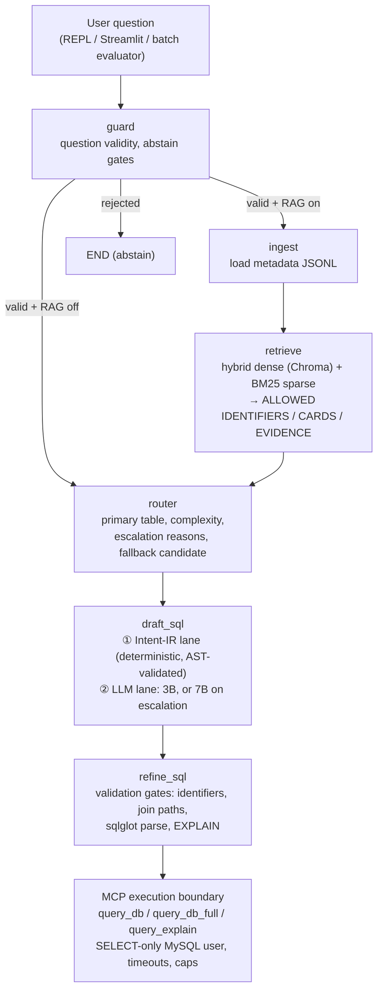

# t2sql — Context-Governed Text-to-SQL Agent for Low-Resource Enterprise Deployment

**t2sql** is a self-hosted, CPU-only Text-to-SQL agent that turns natural-language questions into
verified SQL against a relational database — using **small language models (1.5B–8B) served locally
with Ollama**, instead of a large hosted LLM.

The core idea is **context governance**: rather than hoping a small model can "know" your schema,
the system builds a *narrow, relevant, and safe context* for every question — schema metadata
retrieved from a DataHub catalog, hybrid dense + BM25 retrieval, a deterministic intent structure,
and explicit join/identifier policies — and only then asks the model to draft SQL. Every candidate
query is validated (AST checks, `EXPLAIN`, identifier allow-listing) before it is executed through a
dedicated, read-only MCP execution service.

> Companion conference paper: *Conference Paper — Jovian Aditya Wiranata* (design rationale and
> full evaluation of this system). The code and the committed evaluation logs in
> [`results_and_logs/`](results_and_logs/) are the source of truth; the tables below are derived
> from those logs.

---

## Table of contents

1. [Key features](#key-features)
2. [Architecture](#architecture)
3. [Repository layout](#repository-layout)
4. [Technology stack](#technology-stack)
5. [Prerequisites](#prerequisites)
6. [Quick start](#quick-start)
7. [Configuration](#configuration)
8. [Evaluation](#evaluation)
9. [Design tradeoffs](#design-tradeoffs)
10. [Scalability](#scalability)
11. [Maintainability](#maintainability)
12. [Implementation risks & known limitations](#implementation-risks--known-limitations)
13. [Security notes](#security-notes)
14. [Roadmap](#roadmap)
15. [Citation & license](#citation--license)

---

## Key features

- **Small models only.** Routing (1.5B), drafting (3B), and escalation (7B) models all run on CPU
  via Ollama — no GPU, no external API, no data leaving the machine.
- **Hybrid metadata retrieval.** Schema and business-context metadata is exported from
  [DataHub](https://datahubproject.io/) as JSONL and indexed for retrieval with dense embeddings
  (Chroma + `snowflake-arctic-embed2:568m`) **and** BM25 lexical scoring, with deterministic
  boosting rules for ID/name/metric columns.
- **Two drafting lanes.** A deterministic **Intent-IR lane** (structured intent representation →
  AST-validated SQL plan, sqlglot-checked) and an **LLM lane** (3B, escalating to 7B when the
  router detects complexity), selected per question.
- **Abstain instead of guess.** Question-guard and evidence gates can refuse ambiguous,
  unanswerable, or unsupported questions instead of producing confident garbage.
- **Governed execution boundary.** All SQL runs through a separate FastMCP service
  (`mcp_server`) connected to MySQL with a **SELECT-only DB user**, a 5×5 preview default,
  statement timeouts, row caps, and a database allow-list.
- **Reproducible benchmark harness.** Scenario presets (P1–P5) for different model families,
  ablation switches (`--rag off`, `--intent-ir off`, `--force-model`), EXPLAIN-based validity (VA),
  execution accuracy (EX), and a cross-database Test Suite (TS), exported to Excel + logs.

---

## Architecture



The pipeline is a [LangGraph](https://www.langchain.org/langgraph) state machine
(`t2sql/graph.py`). Every hop is conditional and driven by scenario config, so the same graph
serves full runs, RAG-off ablations, and single-model forced runs. Generation behavior is governed
by policy documents that mirror the code:

| Policy | Purpose |
|---|---|
| [`ROUTING_POLICY.md`](data/python/mcp_client/t2sql/ROUTING_POLICY.md) | How questions are routed to the IR / 3B / 7B lanes |
| [`INTENT_IR_POLICY.md`](data/python/mcp_client/t2sql/INTENT_IR_POLICY.md) | What the Intent IR may express (and what it must not) |
| [`RETRIEVAL_POLICY.md`](data/python/mcp_client/t2sql/RETRIEVAL_POLICY.md) | How the per-question context is built |
| [`JOIN_POLICY.md`](data/python/mcp_client/t2sql/JOIN_POLICY.md) | FROM/JOIN selection, INNER vs LEFT JOIN guidance |
| [`CONFIG_BOUNDARY.md`](data/python/mcp_client/t2sql/CONFIG_BOUNDARY.md) | The 4-layer configuration boundary |

**Execution boundary.** The agent never talks to MySQL directly. A separate FastMCP process
(`data/python/mcp_server/mcp_server.py`) exposes `query_db` (safe 5×5 preview), `query_db_full`
(capped full export), `query_explain` (used for the VA metric), and `list_tables`. It connects as a
SELECT-only user (`data/sql_init/permission.sql`), applies a statement timeout
(`STATEMENT_TIMEOUT_MS`, default 5 s), preview caps (`PREVIEW_ROW_LIMIT`/`PREVIEW_COL_LIMIT`, default
5×5), a max export size, and a database allow-list (`MYSQL_ALLOWED_DATABASES`).

---

## Repository layout

```
text2sql--small-language-model/
├── datahub.yml                  # DataHub stack + MySQL + mcp_server + mcp_client (network: datahub_network)
├── llm.yml                      # Ollama + Chroma (network: llm_network, joins datahub_network)
├── .env                         # runtime config + secrets (never commit; see .env.example)
├── data/
│   ├── ollama/                  # Ollama volume + entrypoint.sh (auto-pulls configured models)
│   ├── chroma/chroma            # Chroma container image build (chromadb/chroma:1.5.5 + curl)
│   ├── sql_init/                # classicmodels schema + shadow DBs (classicmodels_2/3) + permission.sql
│   └── python/
│       ├── mcpserver / mcpclient    # Dockerfiles for the two MCP containers
│       ├── mcp_server/mcp_server.py # FastMCP execution boundary (MySQL tools)
│       ├── mcp_client/              # the t2sql package (see below)
│       │   ├── t2sql/               # core package: graph, agents, retrieval, intent_ir,
│       │   │                        # generation, confidence, rulebook, config, repl, cli, …
│       │   │   ├── *_POLICY.md      # policy docs mirroring runtime behavior
│       │   │   ├── test/            # held-out test set (easy/medium/hard)
│       │   │   ├── development/     # internal evaluation sets
│       │   │   ├── evaluation/      # shadow-database evaluation sets
│       │   │   └── streamlit/       # Streamlit frontend
│       │   └── metadata_jsonl/      # exported dense/sparse/lineage metadata (classicmodels)
│       └── ingestion/               # DataHub ingestion recipe (mysql → DataHub)
├── results_and_logs/            # committed evaluation logs (.log) + result workbooks (.xlsx)
└── notes.txt                    # maintainer runbook (contains commands, DO NOT store secrets here)
```

---

## Technology stack

| Layer | Technology | Notes |
|---|---|---|
| Language models | Ollama 0.18.1 | qwen2.5 1.5b/3b/7b-instruct (default); P2–P5 presets swap in coder models |
| Embeddings | `snowflake-arctic-embed2:568m` | served by the same Ollama instance |
| Vector store | Chroma 1.5.5 | single-node, persisted volume |
| Sparse retrieval | `rank-bm25` | in-process, boosted by deterministic rules |
| SQL validation | `sqlglot` | AST parsing / guards |
| Agent orchestration | LangGraph 1.x | state machine in `t2sql/graph.py` |
| Metadata catalog | DataHub v1.2.0 (Kafka KRaft, Elasticsearch 7.10, MySQL 8) | source of schema/business metadata |
| Database | MySQL 8.0 | `classicmodels` + two shadow copies for generalization tests |
| Execution boundary | FastMCP 3.x | HTTP MCP server on `mcp_server:8000/mcp` |
| UI | Streamlit, REPL (`t2sql-rag` CLI), Jupyter | |
| Language | Python 3.10 (pinned in `pyproject.toml`) | |

---

## Prerequisites

- Docker + Docker Compose v2
- **Memory:** ≈ 30 GB for the full stack (Ollama alone is capped at 20 GB in `llm.yml`; Kafka, ES,
  DataHub, MySQL, Chroma and the two MCP containers take the rest). This system is designed for
  **CPU-only** inference (`OLLAMA_LLM_LIBRARY=cpu_avx2`, 4 threads, single parallel request).
- **Disk:** ≈ 20 GB for the pulled models (router + small + large + embedding model), plus volumes
  for Kafka, Elasticsearch, MySQL and Chroma.
- ~5 GB RAM free on the host for Docker itself.

## Quick start

### 1. Configure the environment

```bash
cp .env.example .env
# then edit .env: set passwords and the DataHub token you will create in step 3

# Generate the Kafka cluster id (KRaft) required by datahub.yml:
docker run --rm confluentinc/cp-kafka:8.0.0 /bin/kafka-storage random-uuid
# paste the printed UUID into .env as KAFKA_CLUSTER_ID=<uuid>
```

### 2. Start the metadata + execution stack

```bash
docker compose -f datahub.yml up -d
```

This starts Kafka, Schema Registry, MySQL (auto-initialized with the classicmodels schema and two
shadow copies), Elasticsearch, DataHub (GMS + frontend), `mcp_server`, and `mcp_client`.
Wait until DataHub is healthy, then create a **personal access token** in the DataHub UI
(`http://localhost:9002`) and put it in `.env` as `DATAHUB_TOKEN=...`.
If you change `.env` afterwards, recreate the containers:

```bash
docker compose -f datahub.yml up -d --force-recreate
```

### 3. Start the model + vector stack

```bash
docker compose -f llm.yml up -d
```

The Ollama entrypoint automatically pulls the models listed in `OLLAMA_PULL_MODELS`
(router / small / large + the embedding model). First start can take a while — the entrypoint
retries each pull three times and logs progress (`docker logs -f ollama`).

### 4. Publish schema metadata to DataHub (one-time per schema)

1. Run the DataHub ingestion recipe (`data/python/ingestion/ingestion_datahub_table.yml`) so
   DataHub ingests tables/columns/lineage from MySQL
   (`data/python/ingestion/ingestion_datahub_lineage.py`).
2. In the `mcp_client` container, create the DataHub domain and tags, then export the metadata to
   JSONL: the notebooks in `data/python/mcp_client/metadata_datahub_collection/`
   (`domain_tags_datahub.ipynb` first, then `graphql_jsonl_sparse.py`, `graphql_jsonl_dense.py`,
   `graphql_jsonl_lineage.py`) page the DataHub GraphQL API and write
   `*_dense.jsonl`, `*_sparse.jsonl`, `*_lineage.jsonl` into `metadata_jsonl/`.
3. The retrieval layer consumes the **sparse** (lexical) and **dense** (vector) JSONL files. Point
   `SPARSE_METADATA_JSONL` / `DENSE_METADATA_JSONL` in `.env` at the exported files.

On the first question, the Chroma collection is built automatically if empty
(`t2sql/chroma_embedding.py`), using the embedding model from Ollama.

### 5. Ask questions

**Interactive REPL** (inside `mcp_client`):

```bash
docker exec -it mcp_client bash -c "cd /app && python -m t2sql.cli"
```

**Streamlit UI** (port 8501):

```bash
docker exec -d mcp_client bash -lc \
  "cd /app && streamlit run t2sql/streamlit/app.py --server.address 0.0.0.0 --server.port 8501"
# open http://localhost:8501
```

**Batch evaluation** (scenario P1, easy test set):

```bash
docker exec -e AGENT_PROMPT_TELEMETRY=1 -it mcp_client bash -c "cd /app && python -m t2sql.testing_evaluation \
  --scenario P1 --testset t2sql/test/qa_classicmodels_test_easy.yml \
  --output results_test_easy_p1.xlsx --easy --warmup-models small"
```

---

## Configuration

Configuration is intentionally split into **four layers** (see
[`CONFIG_BOUNDARY.md`](data/python/mcp_client/t2sql/CONFIG_BOUNDARY.md)):

| Layer | Holds | Examples |
|---|---|---|
| `.env` | per-environment runtime knobs + secrets | endpoints, model names, feature flags, timeouts |
| `t2sql_rules.yml` | long, mostly-static language lexicons | intent phrases, stopword exceptions, EN/ID terms |
| `t2sql_config.yml` | generated lexical defaults (consumed when env overrides are absent) | router/retrieval patterns |
| `config.py` / `rulebook.py` | typed parsing, aliases, defaults | env → constants |

> Rule of thumb from `CONFIG_BOUNDARY.md`: *if the value changes per environment or is a secret,
> it belongs in `.env`. Long phrase lists belong in `t2sql_rules.yml`, which keeps rule changes
> auditable.*

### Key environment variables (full template: [.env.example](.env.example))

| Variable | Default | Purpose |
|---|---|---|
| `OLLAMA_URL` | `http://ollama:11434` | inference endpoint |
| `OLLAMA_PULL_MODELS` | see `.env.example` | models auto-pulled on container start |
| `OLLAMA_KEEP_ALIVE` | `180s` | how long models stay resident between calls |
| `ROUTING_MODEL` / `SMALL_MODEL` / `LARGE_MODEL` | qwen2.5 1.5b / 3b / 7b | the three lane models |
| `MCP_BASE` | `http://mcp_server:8000/mcp` | execution boundary endpoint |
| `MYSQL_ALLOWED_DATABASES` | *(empty = default DB only)* | DB allow-list enforced by `mcp_server` |
| `STATEMENT_TIMEOUT_MS` | `5000` | per-statement execution timeout |
| `SPARSE_METADATA_JSONL` / `DENSE_METADATA_JSONL` | — | retrieval inputs |
| `TOP_K`, `SPARSE_MAX_HITS`, `MAX_CTX_DOCS` | 5 / 20 / 12 | retrieval budget |
| `AGENT_IR_ENABLED`, `AGENT_AST_GUARDS_ENABLED` | 1 | Intent-IR lane + AST validation switches |
| `AGENT_B4_*_ENABLED` | 1 | abstain gates (cannot-answer / ambiguity / evidence) |
| `DOMAIN_HEURISTICS_PROFILE` | `agnostic` | `business` adds domain lexicons (revenue, payment, …) |
| `HITL_ENABLED` | 1 | human-in-the-loop review logging for failed answers |
| `DATAHUB_TOKEN` | — | token for metadata export scripts |

### Model scenarios (P1–P5)

The evaluator (`t2sql/testing_evaluation.py --scenario`) activates one of five model presets to
test how the same governed pipeline behaves across model families:

| Scenario | Router | Small (draft) | Large (escalation) |
|---|---|---|---|
| **P1** (default) | qwen2.5:1.5b-instruct | qwen2.5:3b-instruct | qwen2.5:7b-instruct |
| **P2** (coder) | qwen2.5:1.5b-instruct | qwen2.5-coder:3b | qwen2.5-coder:7b |
| **P3** (granite) | qwen2.5:1.5b-instruct | granite-code:3b-instruct | granite-code:8b-instruct |
| **P4** (mixture) | qwen2.5:1.5b-instruct | stable-code:3b-instruct | deepseek-coder:6.7b-instruct |
| **P5** (starcoder) | starcoder:1b | starcoder2:3b | starcoder2:7b |

---

## Evaluation

### Test set & metrics

- **Held-out test set:** 80 natural-language questions over the classicmodels schema —
  30 easy, 30 medium, 20 hard (`t2sql/test/qa_classicmodels_test_{easy,medium,hard}.yml`).
- **VA (Valid SQL):** generated SQL passes the `EXPLAIN` validity gate on the base database.
- **EX (Execution accuracy):** SQL executes **and** its result matches the ground-truth result set.
- **TS (Test Suite):** the result-match check repeated on distilled shadow databases
  (`classicmodels_2`, `classicmodels_3`) to check schema generalization.
- Latency is the full pipeline (retrieval + routing + drafting + gates + execution) on CPU.

### Main results — P1 (adaptive, default preset)

| Difficulty | Cases | VA | EX | Avg. latency |
|---|---|---|---|---|
| Easy | 30 | **100.0%** | **100.0%** | 33.0 s |
| Medium | 30 | 93.3% | 80.0% | 74.9 s |
| Hard | 20 | 85.0% | 55.0% | 113.7 s |

**Adaptive routing does the work** (P1): final SQL was drafted by the 3B model for 100% of easy,
63.3% of medium, and 20% of hard questions — the 7B model only pays its cost where the router
escalates. IR hints passed for 100% / 53% / 10% of easy/medium/hard respectively.

### Alternative model scenarios (same pipeline, different models)

| Scenario | Easy VA/EX | Medium VA/EX | Hard VA/EX |
|---|---|---|---|
| **P1** qwen2.5-instruct (default) | 100.0 / 100.0 | 93.3 / 80.0 | 85.0 / 55.0 |
| **P2** qwen2.5-coder | 100.0 / 96.7 | 90.0 / 76.7 | 85.0 / 45.0 |
| **P3** granite-code | 100.0 / 100.0 | 73.3 / 40.0 | 65.0 / 20.0 |
| **P4** stable-code + deepseek-coder | 100.0 / 90.0 | 83.3 / 60.0 | 85.0 / 45.0 |
| **P5** starcoder2 | 100.0 / 90.0 | 83.3 / 36.7 | 70.0 / 30.0 |

### Ablations (P1)

| Variant | Easy VA/EX | Medium VA/EX | Hard VA/EX |
|---|---|---|---|
| **Full system (adaptive)** | 100.0 / 100.0 | 93.3 / 80.0 | 85.0 / 55.0 |
| 3B only (no escalation) | 100.0 / 100.0 | 80.0 / 66.7 | 70.0 / 30.0 |
| 7B only (no small model) | 100.0 / 100.0 | 100.0 / 90.0 | 85.0 / 50.0 |
| Intent-IR off | 100.0 / 96.7 | 96.7 / 76.7 | 85.0 / 55.0 |
| RAG off (no retrieval) | 83.3 / 76.7 | 73.3 / 50.0 | 50.0 / 20.0 |

**How to read this honestly:**

- **Retrieval is the single biggest contributor.** Removing RAG costs 23–35 EX points across all
  difficulties — the governed context, not model size, is what makes small models viable.
- **The adaptive system trades a little peak accuracy for a lot of compute.** A 7B-only run scores
  higher on medium (90.0 vs 80.0 EX) but pays 7B cost on 100% of questions; the adaptive system
  reaches 80.0 while using 7B on only 36.7% of medium questions. Escalation buys back most of the
  hard-set gap (55.0 vs 50.0 EX) at 20% 7B usage.
- **Intent-IR's measured effect on this test set is modest** (EX within ~3 points of full). Its
  main value is structural: it produces an auditable intent representation and keeps routing
  decisions explainable, and it contributed the IR hints consumed by the LLM lane.
- Logs for every number above are committed under [`results_and_logs/`](results_and_logs/);
  internal (development) and shadow-database evaluation sets live under
  `data/python/mcp_client/t2sql/{development,evaluation}/`.

---

## Design tradeoffs

| Decision | What it buys | What it costs |
|---|---|---|
| **Deterministic Intent-IR + policy gates instead of a pure LLM agent** | Auditable, testable routing; stable behavior across model swaps; no silent prompt drift | The IR lane only covers a *safe subset* of questions (its own policy forbids scope creep); complex semantics fall back to the LLM lane anyway |
| **Regex/lexicon heuristics (in `t2sql_rules.yml`) instead of a learned semantic parser** | Zero training data, zero GPU, instantly editable per domain, English + Indonesian coverage | Heuristics are tuned to observed question patterns; truly novel phrasings degrade gracefully but not brilliantly; list growth needs curation |
| **Fixed retrieval budget (`TOP_K`, `MAX_CTX_DOCS`) instead of adaptive retrieval** | Predictable latency and prompt size on CPU | Slightly lower ceiling than adaptive expansion (the expand-on-failure path exists but is off by default) |
| **Abstain gates** | Far fewer confident wrong answers; honest "I can't answer this" | Some valid questions get refused; refusal tuning is a product decision |
| **CPU-only single-node Ollama (`OLLAMA_NUM_PARALLEL=1`)** | ~$0 inference cost, data never leaves the host, trivial ops | 33–114 s per question; one query at a time; not suitable for interactive multi-user load as-is |
| **Separate MCP execution boundary** | Enforceable DB allow-list, timeouts, row caps, SELECT-only user, single choke point for audit | One extra hop/service to deploy and monitor |
| **DataHub as the metadata source of truth** | Enterprise-grade lineage/catalog; new tables flow into retrieval without code changes | Heavy stack (Kafka + ES + MySQL + GMS) for a single-schema demo; ingestion must be re-run when schemas change |

## Scalability

**What scales well**

- **Metadata growth.** Retrieval is driven by exported DataHub metadata, not hardcoded schemas.
  Adding tables/domains = re-run ingestion + JSONL export; the retrieval scoring rules are generic
  (ID/name/metric role tags, table-type boosts) and the `DOMAIN_HEURISTICS_PROFILE` layer adds
  per-domain lexicons without touching code.
- **Model swaps.** Models are pure configuration (`*_MODEL` env vars, P1–P5 presets prove the
  pipeline is model-agnostic — the same gates ran across five model families).
- **Schema size.** Context is assembled per question from a small budget (≤ 12 docs, ≤ 3 tables),
  so prompt size stays bounded as the catalog grows; Chroma handles ~10⁵–10⁶ vectors on one node.

**What does not scale (and why)**

- **Throughput.** `OLLAMA_NUM_PARALLEL=1` and CPU inference cap the system at roughly one question
  per 30–115 s. Concurrent users need either a GPU box, replicated Ollama instances, or a
  vLLM-style server with continuous batching (see Roadmap).
- **Single-node stateful stack.** Kafka/ES/MySQL/Chroma run as single replicas with bind-mounted
  or named volumes; there is no HA story, no backup automation, and ES/Kafka memory is capped low
  (2 GB / 256 MB heap) — fine for a benchmark rig, not for production data platforms.
- **Lexicon maintenance.** Every new language or business domain adds curated phrase lists; this is
  linear human effort, not free.

## Maintainability

**Strengths**

- **Policy-as-documentation.** Five `*_POLICY.md` files describe intended runtime behavior and are
  meant to be updated with the code; they make routing/IR/join/retrieval decisions reviewable.
- **Layered configuration** with explicit boundaries (see above) — environment differences stay in
  `.env`; language rules are data, not code.
- **Pinned everything.** Exact dependency versions in `pyproject.toml`, pinned container images,
  deterministic seeds (`OLLAMA_SEED=42`), and committed evaluation logs make runs reproducible.
- **Observability.** Request-id logging in the MCP server, retrieval/routing telemetry flags
  (`AGENT_PROMPT_TELEMETRY`, `RETRIEVAL_TELEMETRY_MAX_ITEMS`), HITL review logs, and per-case
  Excel exports.

**Known debt (stated plainly)**

- `config.py` is ~2,200 lines of env parsing and constants; `helpers_main.py` and `agents.py` are
  very large. Extraction into focused modules would help new contributors.
- Policy docs contain stale absolute paths (`/home/home/thesis/...`) from the original workspace.
- Comments and lexicons mix English and Indonesian; useful for the domain, but inconsistent.
- `notes.txt` is an informal runbook; commands there are authoritative but not scripted.
- No LICENSE/CI historically; this repo now ships an MIT license, but there is no CI pipeline.

## Implementation risks & known limitations

1. **Benchmark-tuning risk.** Lexicons, router patterns, and IR rules were developed against the
   classicmodels benchmark (the `INTENT_IR_POLICY.md` explicitly warns against per-question
   patching). Generalization to a new domain requires re-tuning the `business` profile and
   validating on a fresh question set — budget for this.
2. **LLM hallucination is mitigated, not eliminated.** AST guards, identifier allow-listing, join
   validation, and `EXPLAIN` gates block most invalid SQL, and EX is measured against ground
   truth — but a *valid* query can still be *semantically wrong* (e.g., wrong filter column).
   On hard questions EX is 55%: **always have a human review critical answers** (the HITL logging
   exists for this).
3. **Heuristic SQL normalization.** The MCP server repairs common small-model SQL defects with
   regex (spacing before clauses, alias fixes). Exotic SQL can evade these fixes; they are a safety
   net, not a parser.
4. **Unauthenticated MCP endpoint.** The FastMCP HTTP server (`mcp_server:8000/mcp`) has no auth;
   it is protected only by the Docker network. Do not expose it outside the compose network.
5. **Read-only is enforced at the DB user, not the tool.** `query_db_full` will execute whatever
   SQL reaches it; safety comes from the SELECT-only MySQL grant, timeouts, and row caps. Keep the
   permission model intact.
6. **English + Indonesian coverage only.** The lexicons cover those two languages; other languages
   need new rule content.
7. **Shadow-database assumption.** TS checks assume shadow DBs are structurally identical to the
   base schema (`classicmodels_2/3` in `data/sql_init/`); schema drift between them is not detected.

## Security notes

- **Never commit `.env`, `notes.txt` with tokens, or any real credentials.** Use
  [`.env.example`](.env.example) as the template. *(Maintainer note: earlier commits of this
  repository included real `.env` files and a DataHub token in `notes.txt` — rotate any exposed
  credentials and purge them from history before making the repo public.)*
- The MySQL user used by the agent (`datahub`) is granted **SELECT / SHOW VIEW / CREATE TEMPORARY
  TABLES only** (`data/sql_init/permission.sql`) — no writes, no DDL.
- All data and inference stay on-host (Ollama + DataHub + MySQL), which is the point of the
  low-resource deployment: no external API keys, no data egress.

## Roadmap

From the paper's future-work section and the current code's extension points:

1. **More database domains** — validate and onboard schemas beyond classicmodels. The pipeline is
   already metadata-driven (DataHub ingestion → JSONL export → retrieval), so a new domain
   primarily needs: its ingestion recipe, a `DOMAIN_HEURISTICS_PROFILE` lexicon (domain metric
   terms, semantic aliases), a fresh question set, and re-benchmarking — proving the
   generalization claims outside the original benchmark.
2. **Query caching / response reuse** — repeated analytical questions re-pay full generation cost
   today; a (normalized question → SQL/result) cache is the highest-leverage win.
3. **Result visualization** — generate a chart/graph from query results. The MCP tools already
   return `columns` + `rows`, so the agent can decide (or be asked) whether the answer is
   chartable — e.g., time series, per-category totals, rankings — and render it in the Streamlit
   frontend (with the LLM suggesting an appropriate chart type from the result shape, rendered
   safely as a fixed chart-spec rather than arbitrary code).
4. **Higher-throughput serving** — replace the single-threaded Ollama setup with a batched server
   (vLLM / Multi-LoRA) when moving from benchmark rig to multi-user service.
5. **Learned semantic parsing for the IR lane** — upgrade the regex/lexicon intent extraction to a
   small fine-tuned model while keeping the AST-validated planner.
6. **Broader multilingual coverage** — extend the rule content beyond EN/ID.
7. **CI + packaging** — a pipeline running `ruff` + `pytest` (already configured in
   `pyproject.toml`) and a slim "runtime-only" compose profile without the DataHub stack.

## Citation & license

This system is described in the companion conference paper by **Jovian Aditya Wiranata**. If you
use or build on this work, please cite the paper and this repository.

Released under the [MIT License](LICENSE).
